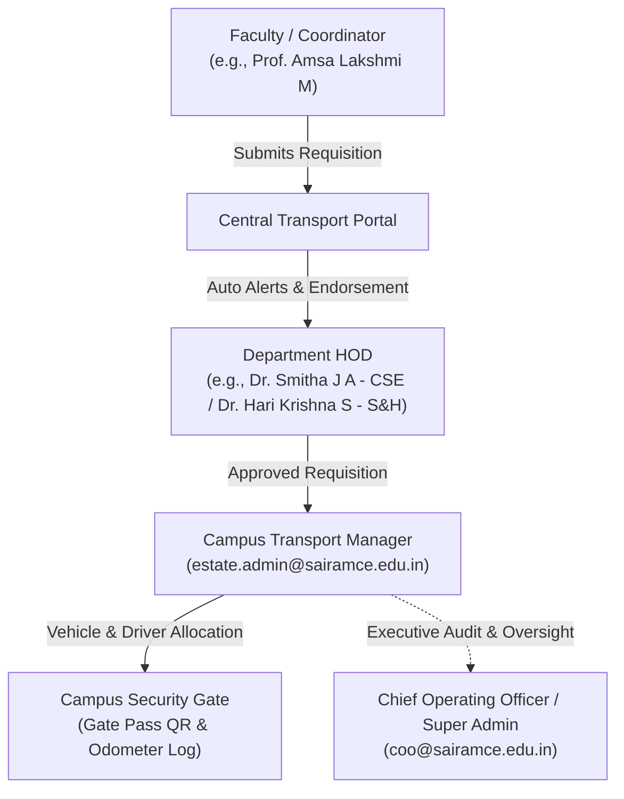
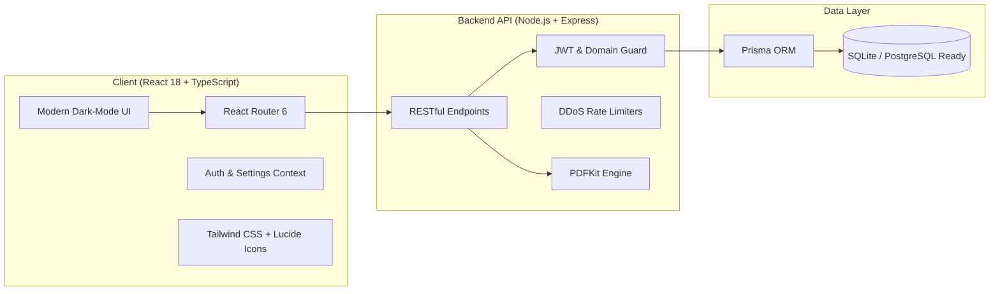

# SRI SAIRAM COLLEGE OF ENGINEERING
### Sai Leo Nagar, Guddanahalli, Anekal, Bengaluru, Karnataka - 562106
## **Institutional Fleet & Central Vehicle Reservation Portal (SSCE-VMS)**
### *Official Project Presentation Dossier & Technical Report*

---

```
Document Reference : SSCE/TRANSPORT/2026/VMS-PR-01
Classification     : Institutional Project Presentation & Implementation Report
Prepared By        : Campus Development & Digital Governance Team
Presented To       : Principal, Chief Operating Officer (COO), Head of Departments (HODs) & Estate Officer
Academic Year      : 2026 - 2027
```

---

## 1. Executive Summary

The **Sri Sairam College Central Vehicle Reservation Portal (SSCE-VMS)** is a custom-engineered, role-based enterprise transport automation system. Designed specifically for Sri Sairam College of Engineering (Anekal, Bengaluru), this digital platform replaces archaic paper-based vehicle requisition forms with an end-to-end automated workflow covering:

1. **Requisition & Multi-Tier Clearances:** Department faculty to HOD endorsement, followed by Transport Superintendent allocation.
2. **Dynamic Fleet Scheduling:** Intelligent conflict detection preventing double-booking across buses, staff cars, and ambulances.
3. **Automated Security Gate Pass:** Real-time generation of digitally verifiable PDF passes featuring tamper-proof QR codes and odometer audit tracking.
4. **Institutional Security:** Domain-locked institutional authentication strictly restricted to `@sairamce.edu.in`.

---

## 2. Problems Addressed: Traditional Paper Process vs. SSCE Digital Portal

| Parameter | Traditional Manual System | SSCE Digital Transport Portal |
|---|---|---|
| **Requisition Speed** | 2 to 4 days of physical file movement across departments | **Under 2 minutes** digital submission from any smartphone or PC |
| **Vehicle Conflict Management** | High risk of double-booking during symposiums and hackathons | **Automated conflict engine**; blocks clashing vehicles in real-time |
| **Driver & Vehicle Allocation** | Phone calls, manual registers, miscommunication | **1-Click visual allocation** with driver contact & WhatsApp duty dispatch |
| **Gate Security Verification** | Paper gate passes prone to loss, damage, or unauthorized tampering | **Tamper-proof PDF Gate Pass** with dynamic QR verification & odometer logs |
| **Audit Trail & Governance** | Paper records difficult to track during NAAC/IQAC inspections | **100% digital audit logging** with date, timestamp, and IP tracking |
| **Access Control** | Open to unauthorized requests | **Strict `@sairamce.edu.in` domain lock** with multi-tier role permissions |

---

## 3. Institutional Hierarchy & Role-Based Access Control (RBAC)



### Detailed Role Matrix:

1. **Faculty / Requisitioner (e.g., Prof. Amsa Lakshmi M):**
   - Submits official vehicle requisition with event title, passenger headcount, departure/return time, and pickup point.
   - Tracks live requisition status (`PENDING` ➔ `APPROVED` ➔ `IN_PROGRESS` ➔ `COMPLETED`).
   - Downloads official digital Gate Pass PDF once approved.

2. **Head of Department - HOD (e.g., Dr. Smitha J A - CSE, Dr. HARI KRISHNA S - S&H):**
   - Reviews and endorses departmental travel requisitions (Industrial visits, Hackathons, Conferences).
   - Validates student participant rosters and ensures safety compliance.

3. **Campus Transport Manager / Super Admin (`estate.admin@sairamce.edu.in`):**
   - Evaluates fleet availability across all campus buses, Innova staff cars, and ambulances.
   - Assigns specific vehicles and drivers with 1-click duty dispatch.
   - Manages maintenance schedules, vehicle blackout dates, and fuel tracking.

4. **Security Officer (Campus Main Gate 1):**
   - Scans digital QR codes on driver and faculty smartphones.
   - Logs outward odometer reading upon departure and inward odometer upon return.

---

## 4. Key Functional Modules Implemented

### Module 1: Fleet Directory & Live Scheduling (`/vehicles`)
- **Fleet Visualizer:** Switch between rich visual vehicle cards and high-density enterprise table view.
- **Smart Filtering:** Live search by vehicle code (`BUS-01`, `CAR-01`, `AMB-01`), capacity dropdown (7 to 55 seats), AC availability, and vehicle type.
- **7-Day Interactive Schedule Modal:** View upcoming 5-day bookings for every single vehicle to ensure zero scheduling conflicts.
- **Instant Driver Contact:** Direct `tel:` calling and pre-formatted WhatsApp duty notification dispatch (`wa.me`).

### Module 2: Booking Engine & Conflict Prevention (`/booking`)
- **Multi-Step Guided Flow:** Basic Info ➔ Headcount Breakdown ➔ Route & Timing ➔ Document Upload.
- **Real-Time Availability Validation:** Checks date, start time, and end time against maintenance records, university holidays, and existing reservations.
- **Sanction Order Attachment:** Secure file upload for departmental permission letters.

### Module 3: Digital Gate Pass & Ticket Generator
- **Branded PDF Generation:** Automated generation of Sri Sairam College official transport pass via `pdfkit`.
- **Dynamic Security QR Code:** Encrypted QR code carrying booking ID, timestamp, driver details, and institutional seal.
- **Odometer Audit Section:** Dedicated sign-off block for Gate Security to record start/return kilometers.

### Module 4: Administrative Management & Oversight (`/admin`)
- **Approval Desk:** Instant 1-click requisition approval or rejection with custom remarks.
- **Fleet Maintenance & Blackout Dates:** Mark vehicles for fitness certification, RTO renewal, or servicing.
- **User Governance:** Add, edit, or deactivate accounts with strict `@sairamce.edu.in` domain enforcement.
- **IQAC & Audit Logs:** Every system action (logins, bookings, approvals, deletions) is timestamped and cryptographically logged for NAAC/NBA inspection.

---

## 5. Technical Architecture



### Technology Stack Specifications:
- **Frontend:** React 18, TypeScript, Tailwind CSS, Lucide React, Vite, HTML5 Canvas, jsPDF.
- **Backend API:** Node.js, Express.js (v4), TypeScript, JWT (JSON Web Tokens), bcrypt.js.
- **Database & ORM:** SQLite (development / standalone) with full Prisma schema readiness for PostgreSQL.
- **Security:** Strict institutional domain enforcement, rate limiting on sensitive routes, sanitized SQL via Prisma.
- **Version Control & Cloud:** Git, GitHub repository ([sairam-campus-transport-portal](https://github.com/gitgaurav-web/sairam-campus-transport-portal)), Render.com cloud blueprint (`render.yaml`).

---

## 6. Official Demonstration Personas (For Live Evaluation)

To present this system smoothly to college authorities, 5 pre-configured official institutional personas are available directly on the login screen with **1-Click Instant Sign-In**:

| Persona Role | Official Name | Email ID | Password | Access Rights & Privileges |
|---|---|---|---|---|
| **SUPER ADMIN** | **Campus Transport Manager** | `estate.admin@sairamce.edu.in` | `password123` | Full fleet control, all approvals, driver rosters, audit logs |
| **ADMIN** | **Arun Kumar R** | `coo@sairamce.edu.in` | `password123` | Transport logistics management & executive review |
| **HOD (CSE)** | **Dr. Smitha J A** | `hod.cse@sairamce.edu.in` | `faculty123` | CSE Department requisition approvals & travel requests |
| **HOD (S&H)** | **Dr. HARI KRISHNA S** | `hod.hs@sairamce.edu.in` | `Hari@123` | Science & Humanities travel approvals |
| **FACULTY (CSE)** | **Prof. Amsa Lakshmi M** | `amsalakshmim.cse@sairamce.edu.in` | `faculty123` | Vehicle requisition submissions & pass downloading |

---

## 7. Recommended 5-Minute Presentation Flow for "Sir"

```
Step 1 (30 seconds) : The Problem Statement
                      "Sir, earlier departmental vehicle booking required physical paperwork,
                      taking 2-3 days and risking vehicle double-booking. We have built an
                      automated, domain-locked portal tailored specifically for Sri Sairam College."

Step 2 (60 seconds) : The Live Fleet Directory (/vehicles)
                      Show all buses, Innova cars, ambulances. Demonstrate the 7-day schedule
                      calendar, AC filters, and 1-click driver WhatsApp dispatch.

Step 3 (90 seconds) : Faculty Booking Submission (/booking)
                      Log in as Prof. Amsa Lakshmi M. Book a bus for a 50-passenger Industrial
                      Visit. Show how intelligent conflict prevention works.

Step 4 (60 seconds) : Admin Approval & Gate Pass Generation (/admin/bookings)
                      Log in as Campus Transport Manager (estate.admin@sairamce.edu.in).
                      Approve the booking, assign driver Ramesh Kumar, and download the
                      official PDF Gate Pass with QR code.

Step 5 (60 seconds) : Institutional Governance & Security
                      Highlight the @sairamce.edu.in domain lock, audit logging for NAAC/IQAC,
                      and complete role segregation.
```

---

## 8. Conclusion & Institutional Impact

The implementation of **SSCE-VMS** transforms Sri Sairam College of Engineering's transport operations into a benchmark digital campus model:
1. **Zero Paperwork:** 100% paperless requisition, endorsement, and pass generation.
2. **Operational Efficiency:** Reduces vehicle turnaround and approval time from days to minutes.
3. **Institutional Accountability:** Real-time visibility into vehicle usage, fuel expenditure, and driver duty schedules.
4. **NAAC & IQAC Audit Readiness:** Ready digital reports available on-demand for accreditation committees.

---
*End of Presentation Dossier — Sri Sairam College of Engineering, Anekal, Bengaluru.*
